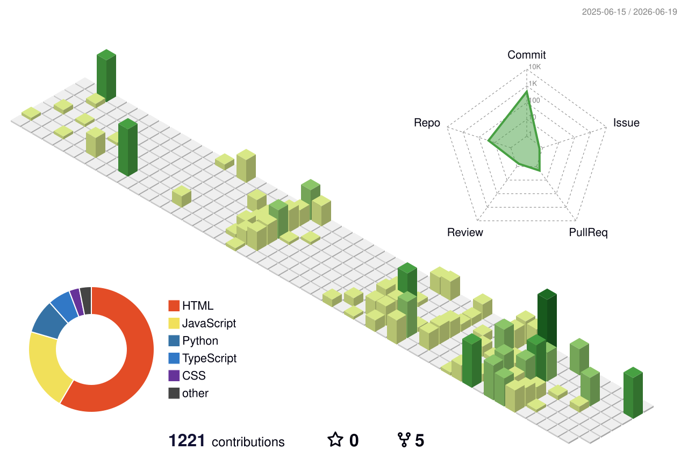

# P G Ayush Rai

**Full-Stack Developer | AI & ML | Software Development Engineer Intern candidate (2027)**

Mysuru, India · B.E. CSE (AI & ML), Vidyavardhaka College of Engineering · CGPA 8.45

  
  
  
  
  

## About

I build full-stack products from scratch and ship them to real users. I work mostly in **Python, React, Node.js and MongoDB**, and I add AI and computer vision where it solves a real problem.

- AI/ML Intern at Turbo India Interconnect Solutions: building full-stack ERP features and an AI assistant with a chatbot interface.
- Built **Evalify**, a multi-tenant AICTE activity-points platform running at VVCE with 700 registered students and 16 mentors.
- Winner of Tech Spark 2025, IEEE Anveshan 2025 and IEEE Bar Camp 2025. Patent filed for a posture-detection model.
- Solving DSA problems in Python on LeetCode.
- Languages: English, Hindi, Kannada, Tulu.

## Featured projects

| Project | What I built | Stack | Links |
| --- | --- | --- | --- |
| **Evalify** | Multi-tenant AICTE activity-points platform. Students upload evidence, mentors verify it, points are calculated and reports are generated. Role-based access, security operations and backups. | React, Node.js, MongoDB | [Live](https://evalify.tech) · [Demo](https://youtu.be/CUAox58apzE) |
| **AsanaMinds** | AI yoga coach with real-time pose detection, posture correction, voice guidance, scoring and progress tracking. Accounts, certificates, web-push reminders and an admin dashboard. | Python, Flask, TensorFlow.js, MongoDB | [Live](https://asanaminds.onrender.com) · [Code](https://github.com/Majenayu/Anveshan) · [Demo](https://youtu.be/1zfEa6RNBq4) |
| **FormPay** | Turns Google Form registrations into Razorpay payment links. Verifies payments with HMAC-SHA256 signed webhooks and replay protection, scores fraud risk with explainable rules, and rate-limits the intake API. | Node.js, TypeScript | [Code](https://github.com/Majenayu/RAZOOOO) |
| **CyberSentinel** | AI-assisted security operations dashboard with threat monitoring, CVE and OSINT lookup, IP reputation, network reconnaissance and Groq-powered incident investigation. | React, Express, MongoDB | [Live](https://cyber-sentinel-clon.onrender.com) · [Code](https://github.com/Majenayu/Cyber-Sentinel) |
| **ErgoTrack** | Posture assessment with MoveNet pose estimation (17 keypoints), joint angles and REBA/RULA ergonomic risk scoring. Patent filed. | Python, TensorFlow, React | [Code](https://github.com/Majenayu/AugmentedVision) |

### More work

- [Python Boot Camp](https://github.com/Majenayu/Python_Boot_Camp): multilingual quiz platform for government schools with live quiz rooms, analytics and leaderboards (Flask, MongoDB).
- [PlacementPro (solve2.0)](https://github.com/Majenayu/solve2.0): campus placement suite for students, alumni and admins ([live](https://solve2-0.onrender.com)).
- [Gram-Verify](https://github.com/Majenayu/Gram-Verify): rural banking verification prototype ([live](https://gram-verify.onrender.com)).
- [TrackSmart](https://github.com/Majenayu/Infosys): QR and GPS delivery tracking with role-based portals (Flask, MongoDB).
- [Virtual Try-On](https://github.com/Majenayu/CodeBreakers-vvce): webcam pose detection with real-time clothing overlays (MediaPipe).

Some projects are private. Reach out if you want a walkthrough.

## Toolkit

**Security:** Hack The Box and TryHackMe labs, with defensive projects like CyberSentinel.

## Leadership

- NCC Cadet Captain leading about 100 cadets. Represented Karnataka at the 25-day Sea Training Camp, Mumbai.
- Vice President of Vectorflow and Event Lead of the IEEE CIE Chapter. Led Vibeathon (sponsored by Kiro), 2 hackathons and 10 workshops.

## Let's connect

If you're working on full-stack products, AI/ML or EdTech, I'd like to hear about it.

[Email](mailto:pgayushrai@gmail.com) · [Portfolio](https://pgayushrai.onrender.com) · [LinkedIn](https://www.linkedin.com/in/p-g-ayush-rai-8b90082a9/) · [LeetCode](https://leetcode.com/u/P_G_Ayush_Rai/)

  
<strong>Contribution views</strong>

   

  <picture>
    <source media="(prefers-color-scheme: dark)" srcset="./profile-3d-contrib/profile-night-green.svg" />
    <source media="(prefers-color-scheme: light)" srcset="./profile-3d-contrib/profile-green.svg" />
    
  </picture>

    

  

